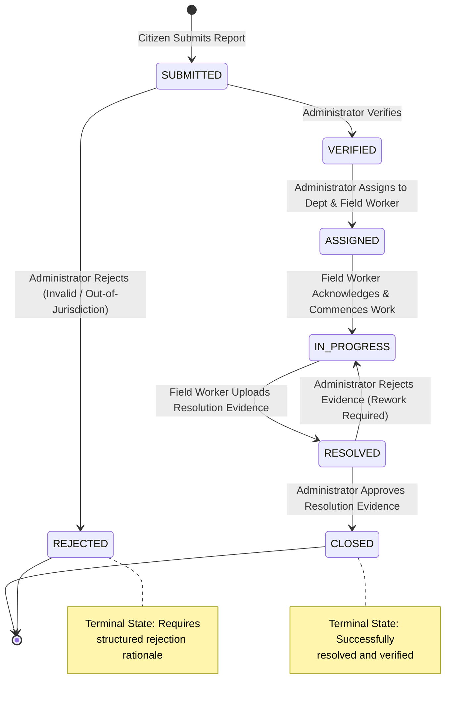

# Ubiquitous Language: FixMyStreet Civic Issue Reporting Platform

> **Document Status**: Official Domain-Driven Design (DDD) Reference  
> **Repository**: [https://github.com/jaydip679/FixMyStreet](https://github.com/jaydip679/FixMyStreet)  
> **Project Name**: FixMyStreet  
> **Target Version**: 1.0.0-draft  
> **Effective Date**: October 2026  

---

## Table of Contents

1. [Introduction and Purpose](#1-introduction-and-purpose)
   - [1.1 Project Overview](#11-project-overview)
   - [1.2 Scope](#12-scope)
   - [1.3 Intended Audience](#13-intended-audience)
   - [1.4 Purpose of a Shared Domain Language](#14-purpose-of-a-shared-domain-language)
2. [Domain Overview](#2-domain-overview)
   - [2.1 Civic Issue Reporting](#21-civic-issue-reporting)
   - [2.2 Main Actors and Their Interactions](#22-main-actors-and-their-interactions)
   - [2.3 The Lifecycle from Reporting to Resolution](#23-the-lifecycle-from-reporting-to-resolution)
3. [Domain Actors](#3-domain-actors)
   - [3.1 Core Actors (Confirmed)](#31-core-actors-confirmed)
   - [3.2 Organizational Entities vs. Software Roles](#32-organizational-entities-vs-software-roles)
   - [3.3 Proposed & Extended Actors](#33-proposed--extended-actors)
4. [Core Domain Glossary](#4-core-domain-glossary)
5. [Domain Entities and Relationships](#5-domain-entities-and-relationships)
   - [5.1 Physical Civic Issue vs. Digital Issue Report](#51-physical-civic-issue-vs-digital-issue-report)
   - [5.2 Principal Domain Entities](#52-principal-domain-entities)
   - [5.3 Domain Value Objects](#53-domain-value-objects)
   - [5.4 Entity-Relationship Overview](#54-entity-relationship-overview)
6. [Issue Lifecycle and State Transitions](#6-issue-lifecycle-and-state-transitions)
   - [6.1 State Definitions](#61-state-definitions)
   - [6.2 Transition Matrix and Authorization Rules](#62-transition-matrix-and-authorization-rules)
   - [6.3 Mermaid State Transition Diagram](#63-mermaid-state-transition-diagram)
   - [6.4 Proposed States and Approval Needs](#64-proposed-states-and-approval-needs)
7. [Business Rules and Invariants](#7-business-rules-and-invariants)
   - [7.1 Confirmed Business Rules](#71-confirmed-business-rules)
   - [7.2 Proposed Business Rules](#72-proposed-business-rules)
8. [Standardized Terminology](#8-standardized-terminology)
   - [8.1 Canonical Terms vs. Ambiguous Synonyms](#81-canonical-terms-vs-ambiguous-synonyms)
   - [8.2 Usage Context Matrix](#82-usage-context-matrix)
9. [Domain Events](#9-domain-events)
   - [9.1 Architectural Clarification](#91-architectural-clarification)
   - [9.2 Confirmed Domain Events](#92-confirmed-domain-events)
   - [9.3 Proposed Domain Events](#93-proposed-domain-events)
10. [Communication Examples](#10-communication-examples)
    - [10.1 Persona-Based Dialogues](#101-persona-based-dialogues)
    - [10.2 Anti-Patterns vs. Canonical Communication](#102-anti-patterns-vs-canonical-communication)
11. [Open Domain Questions](#11-open-domain-questions)
12. [Language Governance](#12-language-governance)
    - [12.1 Application across Technical Artifacts](#121-application-across-technical-artifacts)
    - [12.2 Terminology Evolution and Change Management](#122-terminology-evolution-and-change-management)

---

## 1. Introduction and Purpose

### 1.1 Project Overview
**FixMyStreet** is a community-oriented civic issue reporting and municipal management platform. It empowers citizens to identify, record, and report public infrastructure defects—such as potholes, overflowing garbage, broken streetlights, ruptured water pipes, and structural damage—directly to municipal authorities. The platform facilitates verification, operational dispatch, prioritization, and resolution tracking, closing the feedback loop between the public and municipal government.

### 1.2 Scope
The scope of this document encompasses the core problem domain of civic defect reporting, administrative triage, municipal department dispatch, field remediation, resolution auditing, and citizen status monitoring. It defines the common conceptual vocabulary utilized across the application lifecycle.

* **In Scope**:
  - The life cycle of physical civic infrastructure defects and their digital report representations.
  - Identification and characterization of domain actors (citizens, municipal administrators, field workers, municipal departments).
  - Classification, geographic location tagging, evidentiary verification, assignment, and resolution validation.
  - Business rules, domain events, and state invariants governing problem handling.
* **Out of Scope**:
  - Implementation-specific framework decisions (e.g., ORM choices, frontend styling frameworks, cloud hosting topologies).
  - General municipal internal enterprise resource planning (ERP) outside the civic issue workflow.
  - Municipal financial budgeting and payroll processing for municipal workers.

### 1.3 Intended Audience
This document serves as the single source of truth for:
- **Software Engineers & Architects**: Designing schemas, interfaces, API routes, data structures, and tests.
- **Product Owners & Domain Experts**: Crafting requirements, specifications, and business roadmaps.
- **Municipal Stakeholders & Administrators**: Aligning municipal administrative processes with platform terminology.
- **Quality Assurance & Test Engineers**: Formulating integration, domain rule, and acceptance test cases.

### 1.4 Purpose of a Shared Domain Language
In complex municipal operations, terminology divergence causes critical defects:
- Citizens refer to a problem as a *"complaint"*, developers model it as a *"ticket"*, and municipal administrators classify it as a *"work order"*.
- A field worker may mark a job as *"done"* (remediation completed), while the citizen expects *"done"* to mean that the site has been cleaned and inspected.

Applying Eric Evans' **Domain-Driven Design (DDD)** principles, the Ubiquitous Language provides a rigorous, unambiguous lexicon spoken consistently by technical personnel, administrative actors, and software systems. When a term appears in conversation, source code, database entities, or user interfaces, it conveys exactly one shared semantic meaning.

---

## 2. Domain Overview

### 2.1 Civic Issue Reporting
Civic issue reporting occupies a hybrid socio-technical domain:
1. **Physical Reality**: A localized breakdown or degradation of public infrastructure situated in a public space (e.g., a street, sidewalk, park, or public utility easement).
2. **Digital Representation**: A structured record containing spatial coordinates, photographic proof, categorical classification, and descriptive prose captured by an observer and ingested by the platform.
3. **Operational Workflow**: A municipal pipeline responsible for verifying authenticity, preventing redundant effort, dispatching qualified crews, performing remedial repairs, and preserving evidentiary proof of remediation.

### 2.2 Main Actors and Their Interactions
The FixMyStreet ecosystem coordinates three human roles and one organizational entity:

```
+-----------------------------------------------------------------------------------------+
|                                    FIXMYSTREET ECOSYSTEM                                |
+-----------------------------------------------------------------------------------------+

  [ Citizen / Reporter ]
            |
            | 1. Submits Issue Report (Photos, GPS, Description, Category)
            v
  [ Municipal Administrator / Authority ] <----> [ Department ]
            |                                         |
            | 2. Verifies, Prioritizes, and Assigns   | (Organizational Unit:
            v                                         |  Roads, Sanitation, Water, etc.)
  [ Field Worker / Municipal Employee ] <-------------+
            |
            | 3. Performs Remediation & Uploads Resolution Evidence
            v
  [ Municipal Administrator / Authority ]
            |
            | 4. Reviews Evidence, Resolves, and Closes
            v
  [ Citizen / Reporter ] (Receives Updates & Verifies Public Space)
```

1. **The Citizen** discovers an infrastructure defect and submits a digital **Issue Report** with geographic coordinates and photographic evidence.
2. **The Municipal Administrator** verifies the report, rejects spurious or out-of-scope entries, prioritizes valid reports, and assigns them to the responsible **Department**.
3. **The Department** dispatches a designated **Field Worker** (or crew) equipped to execute physical repairs.
4. **The Field Worker** conducts physical remediation on-site, records operational progress, and captures photographic **Resolution Evidence**.
5. **The Municipal Administrator** audits the resolution evidence, transitions the issue to resolved, and notifies the **Citizen**.

### 2.3 The Lifecycle from Reporting to Resolution
Every civic issue progresses through five primary conceptual phases:
1. **Intake & Submission**: The report is generated, tagged with spatial data and media evidence, and enters the triage queue.
2. **Triage & Verification**: Administrative evaluation confirms that the report represents an authentic, non-duplicate, jurisdictionally actionable civic issue.
3. **Scheduling & Assignment**: Allocation of operational responsibility to a functional municipal department and a designated field worker.
4. **Field Remediation**: Execution of physical work at the geo-tagged location, culminating in the submission of post-remediation evidence.
5. **Validation & Closure**: Verification of satisfactory repair by the authority, formal closure, and publication of the resolution record.

---

## 3. Domain Actors

### 3.1 Core Actors (Confirmed)

#### 1. Citizen / Reporter
* **Definition**: A member of the public, resident, or visitor who encounters a civic infrastructure problem and utilizes the platform to report it.
* **Domain Responsibilities**:
  - Capturing and uploading truthful, relevant photographic evidence.
  - Supplying accurate geographic positioning (via device GPS or interactive map placement).
  - Categorizing the problem appropriately (e.g., Pothole, Streetlight, Garbage).
  - Monitoring progress and acknowledging resolution.
* **Distinction**: The Citizen is external to municipal governance; their privileges are limited to reporting, viewing public issue details, and managing their own submissions.

#### 2. Municipal Administrator / Authority
* **Definition**: An authorized municipal official or administrative supervisor responsible for overseeing civic complaint processing within a defined jurisdiction.
* **Domain Responsibilities**:
  - Reviewing the intake queue for validity, clarity, and authenticity.
  - Rejecting inappropriate, spam, or out-of-jurisdiction reports with explicit rationale.
  - Assessing severity, establishing priority, and delegating assignments to municipal departments or specific employees.
  - Identifying and linking duplicate reports.
  - Auditing completed work and approving resolution.
* **Distinction**: The Administrator possesses system-wide supervisory authority across report workflows, user management, and operational analytics.

#### 3. Department
* **Definition**: A specialized municipal functional or organizational unit legally and operationally tasked with maintaining specific classes of public infrastructure.
* **Domain Responsibilities**:
  - Managing internal resources, tooling, and labor within its operational domain.
  - Maintaining domain-specific Service Level Agreements (SLAs).
* **Examples**:
  - *Public Works / Highways Department*: Potholes, road subsidence, sidewalk cave-ins.
  - *Sanitation & Waste Management*: Uncollected garbage, illegal dumping, dumpster overflow.
  - *Electrical & Streetlighting*: Non-functional streetlights, exposed wiring, damaged light poles.
  - *Water Supply & Sewerage*: Ruptured water mains, sewage overflow, missing storm drain covers.
* **Distinction**: A Department is not an individual person; it is an organizational aggregate to which field workers belong and to which issues are routed based on category.

#### 4. Field Worker / Municipal Employee
* **Definition**: An operational municipal technician, maintenance worker, or crew supervisor deployed on-site to inspect, remediate, or repair physical defects.
* **Domain Responsibilities**:
  - Receiving and reviewing dispatched work assignments.
  - Travelling to the specified GPS location.
  - Updating execution status (e.g., initiating physical repair).
  - Documenting physical repair outcomes by uploading mandatory photographic resolution evidence.
* **Distinction**: The Field Worker operates primarily in the physical space; their interaction with the platform is focused on task execution queues and proof submission.

---

### 3.2 Organizational Entities vs. Software Roles

To avoid conflating physical human institutions with software authorization primitives, FixMyStreet maintains a strict distinction:

| Concept | Real-World Organizational Meaning | Software Authorization Role / Identity |
| :--- | :--- | :--- |
| **Citizen** | A resident of the municipality engaging with civic infrastructure. | `Role: CITIZEN` (Authenticated or guest account with read/submit scope). |
| **Authority / Administrator** | An elected official, municipal commissioner, or ward officer. | `Role: ADMINISTRATOR` (Privileged account with triage, reassignment, and audit scope). |
| **Department** | A bureaucratic branch of municipal government (e.g., Dept of Sanitation). | Domain entity / organizational group; acts as a routing scope, not a single login. |
| **Field Worker** | A certified technician, line-worker, road crew laborer, or contractor. | `Role: FIELD_WORKER` (Mobile/operational account restricted to assigned work queue). |

---

### 3.3 Proposed & Extended Actors

> [!NOTE]
> The following actors are identified as valuable extensions for future governance phases but are currently **Proposed** and not yet committed in initial implementation.

* **Department Supervisor (Proposed)**: An intermediate administrative role within a specific department who receives cross-departmental tickets from the Municipal Administrator and assigns them to specific internal field crews.
* **Public Observer (Proposed)**: An unauthenticated or anonymous visitor browsing public community feeds, maps, and resolved cases without submitting reports.
* **System Administrator (Proposed)**: A technical IT operator managing server infrastructure, system parameters, data backups, and security policies, without civic triage authority.

---

## 4. Core Domain Glossary

The following table establishes the canonical glossary for FixMyStreet. All team members, code artifacts, and user interfaces must use these terms exclusively.

| Term | Definition | Purpose in Domain | Related Terms | Canonical Example |
| :--- | :--- | :--- | :--- | :--- |
| **Civic Issue** | A physical defect, hazard, or failure in public infrastructure situated within municipal boundaries. | Represents the real-world problem that demands remediation. | Defect, Problem, Hazard | *"A 50cm pothole on the eastbound lane of MG Road."* |
| **Issue Report** | The digital, auditable record created in FixMyStreet representing a citizen's complaint regarding a Civic Issue. | Acts as the central aggregate root in software to track lifecycle and evidence. | Report, Complaint, Ticket | *"Issue Report #1042 submitted by Citizen Ramesh on 2026-10-27."* |
| **Citizen** | An individual who notices a civic problem and registers an Issue Report. | Identifies the originator and establishes communication for updates. | Reporter, User, Resident | *"Citizen Ananya reported an overflowing dumpster."* |
| **Location** | The geographic and physical placement of a Civic Issue, combining human-readable address markers and machine coordinates. | Enables field workers to locate and access the physical site accurately. | Address, Landmark, Site | *"Corner of 4th Cross and 8th Main, Indiranagar, Bengaluru."* |
| **GPS Coordinates** | The numerical latitude and longitude expressing the spatial position of a Civic Issue on Earth. | Provides precision geocoding for mapping, spatial queries, and navigation. | Lat/Long, Geolocation | *"Latitude: 12.9716° N, Longitude: 77.5946° E."* |
| **Photograph / Evidence** | An image file captured and uploaded by the reporter depicting the infrastructure defect in its initial state. | Serves as objective prima facie verification of the reported problem. | Photo, Media, Proof | *"pothole_evidence_20261027_01.jpg demonstrating road cave-in."* |
| **Issue Category** | A standardized taxonomy classifying civic problems according to their physical and administrative nature. | Drives automatic routing to the relevant municipal Department. | Classification, Type | *"Water Leakage", "Broken Streetlight", "Pothole", "Garbage Accumulation".* |
| **Severity** | An assessment of the intrinsic hazard, physical extent, or danger posed by a Civic Issue. | Gauges objective physical impact regardless of schedule constraints. | Hazard Level, Extent | *"High Severity: Deep trench across an unlit pedestrian walkway."* |
| **Priority** | The operational urgency assigned to an Issue Report determining scheduling precedence for remediation. | Dictates operational queue ordering based on severity, location, and traffic. | Urgency, Precedence | *"Urgent Priority: Water main burst flooding a major arterial road."* |
| **Verification** | The administrative review process validating that an Issue Report is authentic, actionable, and within jurisdiction. | Prevents wasted municipal resources on invalid, malicious, or out-of-scope reports. | Validation, Triage, Approval | *"Administrator Sharma completed verification of Report #1042."* |
| **Assignment** | The explicit operational binding between an Issue Report, a responsible Department, and a designated Field Worker. | Establishes accountability for physical inspection and repair. | Dispatch, Allocation | *"Report #1042 assigned to Electrical Dept -> Field Worker John Doe."* |
| **Department** | An administrative municipal unit organized around specific civic competencies. | Groups personnel and enforces domain-specific remediation mandates. | Division, Agency, Bureau | *"Department of Public Works", "Department of Sanitation".* |
| **Field Worker** | A municipal employee or certified contractor dispatched to carry out on-site inspection and repairs. | Executes real-world labor and produces verification proof. | Municipal Employee, Crew, Technician | *"Field Worker Khan arrived on site and initiated asphalt patching."* |
| **Issue Status** | The discrete state of an Issue Report within its formal lifecycle model. | Informs stakeholders of the current operational progress. | Lifecycle State, Condition | *`SUBMITTED`, `VERIFIED`, `ASSIGNED`, `IN_PROGRESS`, `RESOLVED`, `CLOSED`.* |
| **Resolution** | The physical completion of all remedial actions necessary to rectify a Civic Issue. | Marks the end of active field repair. | Remediation, Fix, Repair | *"The burst pipe was sealed and water pressure restored."* |
| **Resolution Evidence** | Mandatory photographic or multimedia proof captured after field repair confirming rectification. | Guarantees transparent validation prior to administrative closure. | Completion Proof, After-Photo | *"repair_proof_after_paving.jpg showing level road surface."* |
| **Notification** | An automated system message dispatched to a user communicating an event or status change. | Keeps citizens and workers informed of progress in real time. | Alert, Message, Update | *"Notification: Your report #1042 has been marked RESOLVED."* |
| **Duplicate Report** | A secondary Issue Report describing the identical physical Civic Issue previously reported. | Prevents redundant field dispatches and consolidates citizen interest. | Redundant Report, Clone | *"Report #1049 marked as Duplicate of canonical Report #1042."* |
| **Resolution Timeline** | The immutable chronological ledger of state transitions, comments, and milestones for a report. | Provides auditability, performance analytics, and dispute transparency. | History, Activity Log, Audit Trail | *"Submitted at 09:00 -> Verified at 10:15 -> Assigned at 11:00."* |
| **Escalation** | The process of alerting higher-level authorities when an issue exceeds standard SLA deadlines or hazard limits. | Enforces municipal accountability and prevents stagnant complaints. | SLA Breach, Alerting | *"Report #1042 escalated to Chief Zonal Officer after 72 hours inactive."* |
| **Audit Log** | A secure, tamper-evident log recording all administrative modifications, deletions, and overrides. | Ensures administrative transparency, integrity, and compliance. | System Log, Security Trail | *"Admin User A23 reassigned Report #1042 from Dept A to Dept B at 14:22."* |
| **Analytics** | Aggregate metrics, trends, and spatial heatmaps derived from historical and current Issue Reports. | Guides municipal budget allocation, seasonal planning, and crew performance. | Business Intelligence, Metrics, KPIs | *"Pothole density increased 40% in Ward 12 following monsoon onset."* |

---

## 5. Domain Entities and Relationships

### 5.1 Physical Civic Issue vs. Digital Issue Report

A critical distinction in Domain-Driven Design is separating physical entities from information-system records:

```
+-------------------------------------------------------------------+
|                        PHYSICAL WORLD                             |
|                                                                   |
|   [ Civic Issue ]                                                 |
|   - Real-world infrastructure defect                              |
|   - Exists physically in the environment                          |
|   - Example: A physical crater on 5th Avenue                      |
+-------------------------------------------------------------------+
                                  |
                                  | Observed and reported by
                                  v
+-------------------------------------------------------------------+
|                        DIGITAL DOMAIN                             |
|                                                                   |
|   [ Issue Report (Canonical) ]  <--- Links Duplicate --- [ Report B ]
|   - Digital aggregate root                                        |
|   - Unique identifier, timestamps                                 |
|   - State transitions and audit trail                             |
|   - Geographic coordinates & photos                               |
+-------------------------------------------------------------------+
```

* **Civic Issue**: The concrete, tangible problem in the physical municipality. It exists whether reported or not. Multiple citizens may encounter and photograph the same Civic Issue.
* **Issue Report**: The digital aggregate root residing in FixMyStreet. An Issue Report possesses a life cycle, database identifier, metadata, and state machine.
* **Relationship**: One physical Civic Issue may spawn multiple digital Issue Reports. FixMyStreet handles this via canonical issue linking (Duplicate Report handling).

---

### 5.2 Principal Domain Entities

#### 1. IssueReport (Aggregate Root)
* **Identity**: Unique report identifier (`reportId`).
* **Attributes**: `title`, `description`, `category`, `status`, `severity`, `priority`, `createdAt`, `updatedAt`, `resolvedAt`.
* **Encapsulated Value Objects**: `Location`, `IssueEvidence`, `ResolutionEvidence`.
* **Invariants**:
  - Cannot transition to `ASSIGNED` without a verified `Department`.
  - Cannot transition to `RESOLVED` without at least one valid `ResolutionEvidence` item.
  - Cannot transition to `CLOSED` without being previously `RESOLVED` or `REJECTED`.

#### 2. Citizen (Entity)
* **Identity**: Unique user identifier (`citizenId`).
* **Attributes**: `fullName`, `contactPhone`, `emailAddress`, `registrationDate`, `accountStatus`.
* **Relationships**: Submits 0..* `IssueReport`s; receives 0..* `Notification`s.

#### 3. MunicipalAdministrator (Entity)
* **Identity**: Unique administrative identifier (`administratorId`).
* **Attributes**: `fullName`, `officialDesignation`, `jurisdictionZone`, `workEmail`.
* **Responsibilities**: Performs triage, validates verification, manages cross-departmental escalations.

#### 4. Department (Entity)
* **Identity**: Unique department identifier (`departmentId`).
* **Attributes**: `name`, `code` (e.g., `DEPT_PWD`, `DEPT_ELEC`), `serviceCategories`, `contactLead`.
* **Relationships**: Employs 1..* `FieldWorker`s; handles assigned `IssueReport`s corresponding to its categories.

#### 5. FieldWorker (Entity)
* **Identity**: Unique employee identifier (`workerId`).
* **Attributes**: `fullName`, `badgeNumber`, `departmentId`, `operationalStatus` (Active, On-Duty, Off-Duty), `contactPhone`.
* **Relationships**: Belongs to 1 `Department`; accepts 0..* assigned `IssueReport`s.

#### 6. ResolutionRecord (Entity / Child Aggregate)
* **Identity**: Unique resolution record identifier (`resolutionId`).
* **Attributes**: `completionNotes`, `timestamp`, `workerId`, `evidenceCollection`.

---

### 5.3 Domain Value Objects

Value objects carry semantic attributes, are defined solely by their values, and are strictly immutable:

1. **Location**:
   - `latitude`: Decimal degrees (-90.0 to +90.0).
   - `longitude`: Decimal degrees (-180.0 to +180.0).
   - `streetAddress`: Human-readable localized address line.
   - `landmark`: Distinctive nearby reference feature (optional).
   - `wardNumber`: Municipal ward or district identifier.
2. **IssueCategory**:
   - Enumerated categorical classification (`POTHOLE`, `GARBAGE`, `STREETLIGHT`, `WATER_LEAKAGE`, `DRAINAGE`, `INFRASTRUCTURE_OTHER`).
3. **SeverityLevel**:
   - Enumerated value: `LOW`, `MEDIUM`, `HIGH`, `CRITICAL`.
4. **PriorityLevel**:
   - Enumerated value: `LOW`, `NORMAL`, `URGENT`, `EMERGENCY`.
5. **IssueEvidence**:
   - `mediaUrl`: Immutable locator of photographic asset.
   - `capturedAt`: Timestamp of capture.
   - `mimeType`: Format (`image/jpeg`, `image/png`, `image/webp`).
   - `fileSizeBytes`: Bounded asset size.

---

### 5.4 Entity-Relationship Overview

```
+----------------+          1..* submits          +------------------+
|    Citizen     | -----------------------------> |   IssueReport    |
+----------------+                                +------------------+
                                                    | 1            | 1
                                                    | has          | has
                                                    v              v
                                             +------------+  +--------------+
                                             |  Location  |  | IssueEvidence|
                                             |  (Value)   |  |   (Value)    |
                                             +------------+  +--------------+
                                                    |
                                                    | 1..* assigned to
                                                    v
+----------------+          1..* employs          +------------------+
|   Department   | -----------------------------> |   FieldWorker    |
+----------------+                                +------------------+
        |                                                   |
        | routes to                                         | executes & documents
        v                                                   v
+--------------------------------------------------------------------+
|                         ResolutionRecord                           |
|       - Contains ResolutionEvidence (After-Photos)                 |
+--------------------------------------------------------------------+
```

---

## 6. Issue Lifecycle and State Transitions

### 6.1 State Definitions

FixMyStreet mandates seven confirmed, deterministic lifecycle states for an Issue Report:

| State | Semantic Meaning | Pre-Condition | Terminal State? |
| :--- | :--- | :--- | :--- |
| **`SUBMITTED`** | The Issue Report has been created and logged by a Citizen; it resides in the intake queue awaiting administrative triage. | Complete payload with location and photo. | No |
| **`VERIFIED`** | An Administrator has inspected the report and confirmed it as an authentic, actionable public infrastructure defect. | `SUBMITTED` state; passed validity check. | No |
| **`ASSIGNED`** | The report has been formally directed to a specific Department and dispatched to a Field Worker. | `VERIFIED` state; valid department & worker. | No |
| **`IN_PROGRESS`**| The assigned Field Worker has acknowledged the assignment and commenced physical work or inspection on-site. | `ASSIGNED` state; worker on-site. | No |
| **`RESOLVED`** | Physical remedial repairs have been completed, and required resolution evidence has been uploaded. | `IN_PROGRESS` state; resolution photo uploaded. | No |
| **`CLOSED`** | The resolution has been audited and approved by an Administrator, or confirmed by the Citizen. Lifecycle complete. | `RESOLVED` state; audit clearance. | **Yes** |
| **`REJECTED`** | The report was evaluated and determined to be out of municipal jurisdiction, fraudulent, spam, or non-actionable. | `SUBMITTED` state; rejection reason logged. | **Yes** |

---

### 6.2 Transition Matrix and Authorization Rules

| Origin State | Destination State | Triggering Action | Authorized Actor | Invariant / Validation Rule |
| :--- | :--- | :--- | :--- | :--- |
| `[None]` | `SUBMITTED` | `SubmitReport` | Citizen | Mandatory: Title, Description, Location (Lat/Long), Valid Photo Evidence. |
| `SUBMITTED` | `VERIFIED` | `VerifyReport` | Administrator | Authenticity verified; no duplicate conflict. |
| `SUBMITTED` | `REJECTED` | `RejectReport` | Administrator | Mandatory rejection reason code must be specified. |
| `VERIFIED` | `ASSIGNED` | `AssignWork` | Administrator | Target Department must service the report's category; Field Worker must be assigned. |
| `ASSIGNED` | `IN_PROGRESS` | `StartWork` | Field Worker | Worker acknowledges dispatch and indicates work commencement. |
| `IN_PROGRESS` | `RESOLVED` | `CompleteWork` | Field Worker | Mandatory: At least one Resolution Evidence photograph attached. |
| `RESOLVED` | `CLOSED` | `ApproveResolution`| Administrator | Evidence verified as meeting municipal repair quality standards. |
| `RESOLVED` | `IN_PROGRESS` | `RejectResolution` | Administrator | Evidence deemed insufficient; re-dispatched for additional remediation. |

---

### 6.3 Mermaid State Transition Diagram



---

### 6.4 Proposed States and Approval Needs

The following states are identified for subsequent operational phases and are pending formal administrative approval:

1. **`DUPLICATE_MERGED` (Proposed)**:
   - *Meaning*: Assigned when a report is flagged as matching an already active canonical report. The duplicate is linked to the primary report; subscribers receive mirrored updates.
   - *Approval Need*: Requires definition of whether the duplicate reporter receives independent notifications or unified digest alerts.
2. **`ESCALATED` (Proposed)**:
   - *Meaning*: Automatically or manually applied when an issue exceeds the contractual SLA response or resolution window.
   - *Approval Need*: Requires formal definition of escalation thresholds per category and department.
3. **`REOPENED` (Proposed)**:
   - *Meaning*: Transition triggered when a citizen disputes a `RESOLVED` status within a 48-hour feedback window, asserting that the physical defect remains unrepaired.
   - *Approval Need*: Requires operational policy to prevent malicious loops and define citizen dispute authority.

---

## 7. Business Rules and Invariants

### 7.1 Confirmed Business Rules

#### 1. Report Submission Rules
* **BR-SUB-01 (Mandatory Data Points)**: Every Issue Report must specify an Issue Category, a non-empty descriptive title, a detailed text description, a geographic Location (latitude and longitude), and at least one Photograph of evidence.
* **BR-SUB-02 (Spatial Boundary Enforcement)**: GPS coordinates must fall within the defined administrative boundaries of the governing municipality. Submissions outside municipal coordinates must be prevented at intake.
* **BR-SUB-03 (Media Payload Restrictions)**: Uploaded photographic evidence must adhere to allowed MIME types (`image/jpeg`, `image/png`, `image/webp`) and not exceed a maximum payload limit of 5 Megabytes per image.

#### 2. Verification and Triage Rules
* **BR-VER-01 (Administrative Prerogative)**: Only authenticated Municipal Administrators may execute `VerifyReport` or `RejectReport` operations.
* **BR-VER-02 (Mandatory Rejection Rationale)**: An Issue Report cannot transition to `REJECTED` without capturing a structured rejection category (e.g., `OUT_OF_JURISDICTION`, `PRIVATE_PROPERTY`, `INSUFFICIENT_INFORMATION`, `SPAM`) accompanied by descriptive explanatory notes.

#### 3. Severity vs. Priority Rules
* **BR-PRI-01 (Independence of Severity and Priority)**: Severity evaluates the objective physical hazard of the defect (e.g., a deep pothole is `Severity: HIGH`). Priority represents operational scheduling urgency, calculated by combining severity, location density, and arterial road status.
* **BR-PRI-02 (Default Priority Baseline)**: Reports enter the system with a default priority of `NORMAL` unless escalated by administrative intervention or emergency categorization.

#### 4. Assignment Invariants
* **BR-ASN-01 (Categorical Compatibility)**: An Issue Report can only be assigned to a Department whose mandated scope includes the report’s `IssueCategory`.
* **BR-ASN-02 (Single Active Assignee)**: At any single point in time, an Issue Report has exactly one primary assigned Department and at most one designated active Field Worker. Reassignment supersedes previous worker bindings.

#### 5. Resolution Evidence Invariant
* **BR-RES-01 (Mandatory Proof of Resolution)**: A Field Worker cannot transition an Issue Report to `RESOLVED` without uploading at least one photograph of `Resolution Evidence` depicting the rectified physical site.
* **BR-RES-02 (Administrative Audit Requirement)**: An Issue Report cannot be transitioned to `CLOSED` without explicit verification of the resolution evidence by an Administrator.

#### 6. Citizen Visibility and Auditability
* **BR-VIS-01 (Public Accountability)**: The current `IssueStatus`, category, general location, and photographic evidence of non-sensitive public issues are publicly visible on the community map/feed.
* **BR-VIS-02 (Immutable History)**: Once recorded, state transitions, timestamps, and actor identifiers are appended immutably to the `Resolution Timeline`. No historical transitions may be edited or deleted.

---

### 7.2 Proposed Business Rules

> [!NOTE]
> The following rules represent proposed design enhancements requiring administrative and technical review before production enforcement.

* **P-BR-DUP-01 (Automated Duplicate Heuristics)**: Reports submitted within a 25-meter radius sharing the same `IssueCategory` within a rolling 7-day period should be flagged automatically for Administrator review as potential duplicates.
* **P-BR-SLA-01 (SLA-Driven Escalation)**: Reports lingering in `SUBMITTED` status for more than 48 hours, or in `ASSIGNED` status for more than 120 hours without an update, automatically trigger system alerts to the Chief Municipal Administrator.
* **P-BR-CIT-01 (Citizen Dispute Grace Period)**: Following a transition to `RESOLVED`, the reporting Citizen possesses a 48-hour dispute window to challenge resolution quality with counter-evidence before the system automatically executes `ApproveResolution` -> `CLOSED`.
* **P-BR-REP-01 (Gamification and Civic Reputation)**: Citizens earn reputation points upon verified report submission and successful closure, discouraging fraudulent reporting.

---

## 8. Standardized Terminology

To prevent misunderstandings between citizens, engineers, and municipal authorities, FixMyStreet specifies canonical domain terms and deprecates ambiguous synonyms.

### 8.1 Canonical Terms vs. Ambiguous Synonyms

```
+-------------------------------------------------------------------------------+
|                       CANONICAL VOCABULARY STANDARDS                          |
+-------------------------------------------------------------------------------+
  USE CANONICAL TERM               DO NOT USE (DEPRECATED SYNONYMS)
  -------------------------------- ----------------------------------------------
  Civic Issue                      Problem, Trouble, Bug, Grievance
  Issue Report                     Complaint, Ticket, Form, Case, Job
  Citizen                          User, Customer, End-User, Client
  Location                         Place, GPS, Pin, Coords
  Verification                     Approval, Checking, Sanity Test, Vetting
  Assignment                       Dispatch, Delegation, Allocation, Routing
  Field Worker                     Labourer, Technician, Fixer, Handyman
  Resolution                       Fix, Patch, Solved, Completion
  Resolution Evidence              After-Photo, Proof, Completion Picture
  Closure                          Done, Resolved, Finished, Archival
+-------------------------------------------------------------------------------+
```

### 8.2 Usage Context Matrix

| Canonical Term | Deprecated Synonym | Semantic Justification |
| :--- | :--- | :--- |
| **Civic Issue** | *Problem*, *Bug*, *Grievance* | "Problem" is colloquial and vague; "Bug" refers to software code flaws; "Grievance" denotes administrative labor disputes. "Civic Issue" accurately describes public infrastructure failures. |
| **Issue Report** | *Ticket*, *Complaint*, *Form* | "Ticket" trivializes the civic process into IT helpdesk jargon; "Complaint" carries negative bureaucratic connotations. "Issue Report" emphasizes factual, objective reporting. |
| **Citizen** | *Customer*, *User*, *Client* | Public services do not operate on commercial customer-vendor relationships. Residents are stakeholders in municipal democracy ("Citizens"). |
| **Verification** | *Approval*, *Validation* | "Approval" implies sanctioning or agreeing with a request; "Verification" signifies factual confirmation that the reported defect genuinely exists. |
| **Assignment** | *Dispatch*, *Delegation* | "Delegation" relates to managerial authority transfer; "Assignment" explicitly connects an operational task to a specific department or worker. |
| **Field Worker** | *Technician*, *Labourer* | "Labourer" is culturally insensitive; "Technician" excludes general maintenance staff. "Field Worker" describes any operational staff deployed on-site. |
| **Resolution** | *Fix*, *Patch* | "Patch" suggests a temporary workaround. "Resolution" denotes complete operational remediation of the physical defect. |
| **Resolution Evidence** | *After-Photo*, *Proof* | "Proof" is legally ambiguous; "Resolution Evidence" specifies photographic or sensory documentation demonstrating completed remediation. |
| **Closure** | *Finished*, *Archival* | Closure denotes administrative finalization after quality inspection, distinguishing the end of the lifecycle from physical repair completion (`Resolution`). |

---

## 9. Domain Events

### 9.1 Architectural Clarification
While the initial release of FixMyStreet does not mandate a fully decoupled Event-Driven Architecture (EDA) broker (such as Kafka or RabbitMQ), Domain-Driven Design recognizes **Domain Events** as vital domain concepts representing state-altering occurrences within the domain lifecycle.

### 9.2 Confirmed Domain Events

The following domain events are formally defined and must be represented in system logging, audit trails, and notification triggers:

```
[IssueReportSubmitted] 
         |
         v
[IssueReportVerified]  --- (or) --->  [IssueReportRejected]
         |
         v
  [IssueAssigned]
         |
         v
[IssueWorkStarted]
         |
         v
 [IssueResolved]
         |
         v
  [IssueClosed]
```

#### 1. `IssueReportSubmitted`
* **Trigger**: A Citizen successfully posts a valid issue submission.
* **Payload Attributes**: `reportId`, `citizenId`, `category`, `location`, `timestamp`, `evidenceUrls`.
* **Domain Impact**: Enters the report into the Administrator triage queue; sends confirmation notification to the Citizen.

#### 2. `IssueReportVerified`
* **Trigger**: An Administrator confirms report validity and actionability.
* **Payload Attributes**: `reportId`, `administratorId`, `verifiedAt`, `assignedSeverity`, `assignedPriority`.
* **Domain Impact**: Moves report to the assignment pool; notifies Citizen of verification.

#### 3. `IssueReportRejected`
* **Trigger**: An Administrator declines a report.
* **Payload Attributes**: `reportId`, `administratorId`, `rejectedAt`, `rejectionReasonCode`, `rejectionNotes`.
* **Domain Impact**: Terminates report lifecycle; notifies Citizen with explanatory rationale.

#### 4. `IssueAssigned`
* **Trigger**: An Administrator binds a report to a Department and Field Worker.
* **Payload Attributes**: `reportId`, `departmentId`, `workerId`, `assignedAt`.
* **Domain Impact**: Adds task to the Field Worker’s active queue; notifies Department lead and Field Worker.

#### 5. `IssueWorkStarted`
* **Trigger**: A Field Worker updates the status indicating on-site repair has commenced.
* **Payload Attributes**: `reportId`, `workerId`, `startedAt`.
* **Domain Impact**: Updates public status to `IN_PROGRESS`; records worker on-site arrival.

#### 6. `IssueResolved`
* **Trigger**: A Field Worker submits resolution evidence indicating physical work is complete.
* **Payload Attributes**: `reportId`, `workerId`, `resolvedAt`, `resolutionEvidenceUrls`, `remediationNotes`.
* **Domain Impact**: Alerts Administrator that report is ready for audit; updates Citizen notification stream.

#### 7. `IssueClosed`
* **Trigger**: An Administrator audits and approves the resolution evidence.
* **Payload Attributes**: `reportId`, `administratorId`, `closedAt`, `qualitySignoff`.
* **Domain Impact**: Reaches terminal state; marks case officially complete in municipal records.

---

### 9.3 Proposed Domain Events

* **`IssueReportDuplicateFlagged` (Proposed)**: Triggered when an automated heuristic or Administrator links an Issue Report as a duplicate of an existing canonical issue.
* **`IssueEscalated` (Proposed)**: Triggered when an Issue Report violates SLA duration thresholds, alerting higher-level municipal directors.
* **`IssueReopened` (Proposed)**: Triggered when a Citizen formally disputes a `RESOLVED` status with counter-evidence during the feedback window.

---

## 10. Communication Examples

To foster consistent language adoption, the following scenarios illustrate domain terms in daily operations.

### 10.1 Persona-Based Dialogues

#### Scenario A: Citizen Submitting and Inquiring via Municipal Helpline
* **Ambiguous Conversation**:
  > **Citizen**: *"I called to check on that ticket I filed yesterday about the big hole in the road. Why isn't it fixed?"*  
  > **Helpline Staff**: *"Let me look up your complaint. The ticket is currently pending approval by the office."*
* **Canonical Domain Conversation**:
  > **Citizen**: *"I am inquiring about **Issue Report #1042** regarding a high-severity **Pothole** on Nehru Street. Has it been verified?"*  
  > **Helpline Staff**: *"Yes, your **Issue Report** underwent **Verification** this morning. The **Administrator** has classified it as **Priority: URGENT** and completed **Assignment** to the **Department of Public Works**."*

#### Scenario B: Administrator Dispatching to a Field Worker
* **Ambiguous Conversation**:
  > **Administrator**: *"Hey, take this job over by the park. Some guy complained about water. Go fix it and mark it done."*  
  > **Worker**: *"Okay, I'll close it out when I finish."*
* **Canonical Domain Conversation**:
  > **Administrator**: *"You have a new **Assignment** for **Issue Report #1088** classified under **Issue Category: Water Leakage**. The **Location** coordinates place the rupture at the north corner of Central Park."*  
  > **Field Worker**: *"Understood. I will acknowledge the assignment, set status to **IN_PROGRESS** when our crew arrives on site, and upload **Resolution Evidence** once the pipe replacement is completed."*

---

### 10.2 Anti-Patterns vs. Canonical Communication

| Ambiguous Anti-Pattern | Canonical Alternative | Reason for Correction |
| :--- | :--- | :--- |
| *"The user created a complaint ticket with some pictures."* | *"The **Citizen** submitted an **Issue Report** with photographic **Evidence**."* | Eliminates IT helpdesk jargon ("ticket", "complaint") in favor of civic domain entities. |
| *"We need to approve the ticket before giving it to a technician."* | *"The **Administrator** must complete **Verification** before executing **Assignment** to a **Field Worker**."* | Distinguishes administrative verification of truth from operational labor assignment. |
| *"I patched the problem and marked the ticket finished."* | *"I completed physical remediation, uploaded **Resolution Evidence**, and transitioned the status to **RESOLVED**."* | Clarifies that resolution requires photographic proof and precedes administrative **Closure**. |
| *"The system closed the bug because someone already reported it."* | *"The **Administrator** identified the report as a **Duplicate Report** and linked it to the canonical **Issue Report**."* | Clarifies civic issue identity versus digital report duplication. |

---

## 11. Open Domain Questions

The following domain requirements remain genuinely undecided in the initial project requirements and require collaborative resolution between municipal authorities and technical leads:

1. **Anonymous Reporting vs. Mandatory Citizen Authentication**:
   - *Question*: Should citizens be permitted to submit Issue Reports anonymously (to encourage reporting of sensitive civic safety hazards), or must all submissions require verified identity (e.g., OTP-verified mobile number) to mitigate malicious spam and false reporting?
   - *Current Status*: Undecided. Recommended for initial testing: permit unauthenticated submission with IP rate-limiting, transitioning to mobile verification in production.
2. **Duplicate Detection and Resolution Mechanism**:
   - *Question*: When multiple citizens report the same physical defect, should secondary reports be automatically merged into the canonical Issue Report, or should an Administrator manually link them? When the canonical report is resolved, are all duplicate reporters notified?
   - *Current Status*: Undecided. Heuristic duplicate detection is currently proposed.
3. **Automated vs. Manual Severity and Priority Calculation**:
   - *Question*: Should `Severity` and `Priority` be determined algorithmically by the platform (based on category weights, citizen upvotes, and road traffic density metadata), or remain strictly an administrative triage decision?
   - *Current Status*: Manual triage by Municipal Administrator is confirmed; automated scoring algorithms remain undecided.
4. **Citizen Resolution Dispute and Reopening Policy**:
   - *Question*: Does a citizen have the authority to reject a `RESOLVED` status if they observe the defect is poorly repaired? If so, what is the dispute window duration (e.g., 48 hours vs. 7 days), and what evidence is required to reopen an issue?
   - *Current Status*: Undecided. Currently, administrative approval governs the transition from `RESOLVED` to `CLOSED`.
5. **Automated Escalation Triggers and Governance**:
   - *Question*: Should the system automatically escalate stagnant reports to senior municipal commissioners when departmental SLAs are breached, or should escalation be an exclusively manual supervisor action?
   - *Current Status*: Undecided. Requires municipal SLA legal guidelines.
6. **Criteria for Final Closure (`CLOSED`)**:
   - *Question*: Does an Issue Report transition automatically from `RESOLVED` to `CLOSED` after an elapsed time period without citizen objection, or does it strictly require an Administrator to sign off?
   - *Current Status*: Manual administrative audit is currently established; auto-closure timeout rules remain undecided.

---

## 12. Language Governance

### 12.1 Application across Technical Artifacts

To prevent linguistic drift, the Ubiquitous Language defined in this document must be strictly enforced across all software artifacts:

1. **Source Code (Class, Variable, and Method Names)**:
   - Use `IssueReport`, never `Ticket`, `Complaint`, or `Bug`.
   - Use `ResolutionEvidence`, never `ProofPic` or `AfterImage`.
   - Method signatures must reflect domain verbs: `verifyReport()`, `assignDepartment()`, `submitResolutionEvidence()`, not `doApprove()` or `setDone()`.
2. **Database Schemas and Collections**:
   - Entities must be named `issue_reports`, `departments`, `field_workers`, and `audit_logs`.
   - Foreign keys must use canonical identifiers: `report_id`, `worker_id`, `department_id`.
   - Status columns must use enumerated canonical status values (`SUBMITTED`, `VERIFIED`, `ASSIGNED`, `IN_PROGRESS`, `RESOLVED`, `CLOSED`, `REJECTED`).
3. **RESTful API Contracts**:
   - Resource URIs must reflect canonical plural nouns:
     * `POST /api/v1/issue-reports` (Report submission)
     * `POST /api/v1/issue-reports/{id}/verification` (Triage verification)
     * `POST /api/v1/issue-reports/{id}/assignment` (Departmental assignment)
     * `POST /api/v1/issue-reports/{id}/resolution` (Resolution submission)
     * `POST /api/v1/issue-reports/{id}/closure` (Administrative closure)
4. **Automated Test Suites**:
   - BDD and unit test descriptions must express business behaviors in ubiquitous language:
     * `it("should allow an Administrator to verify a SUBMITTED IssueReport")`
     * `it("should reject resolution when ResolutionEvidence photograph is missing")`
5. **Documentation & User Interfaces**:
   - Citizen UI forms must label inputs as "Photograph of Issue", "Location", and "Issue Category".
   - Field worker screens must display "Assigned Work Queue" and "Upload Resolution Evidence".

---

### 12.2 Terminology Evolution and Change Management

The Ubiquitous Language is a living document that must evolve with the domain:

1. **Proposing Terminology Additions or Modifications**:
   - Any team member (engineer, municipal stakeholder, product manager) may submit a Request for Change (RFC) proposing a new term, modified definition, or lifecycle state.
2. **Review and Consensus**:
   - Proposals must be reviewed by both a Technical Lead and a Municipal Domain Expert.
   - Ambiguous synonyms, colloquialisms, or conflicting definitions must be evaluated against existing domain entities.
3. **Synchronization and Versioning**:
   - Upon consensus, `UBIQUITOUS_LANGUAGE.md` must be updated, versioned, and merged into the root of the repository.
   - Refactoring tasks must be scheduled immediately to align any divergent code, API contracts, or database schemas with the updated language.
